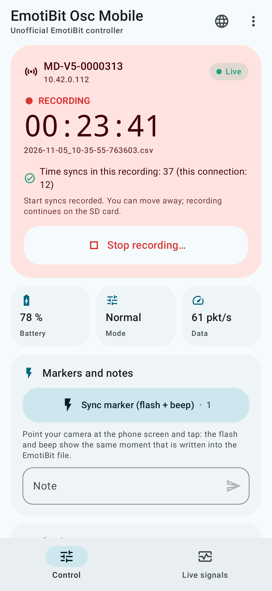
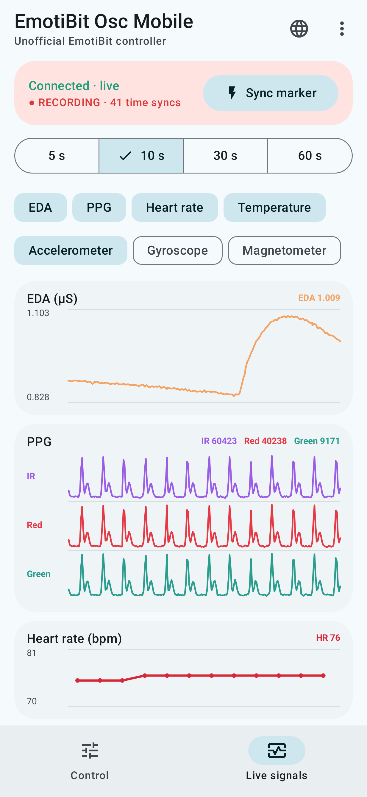
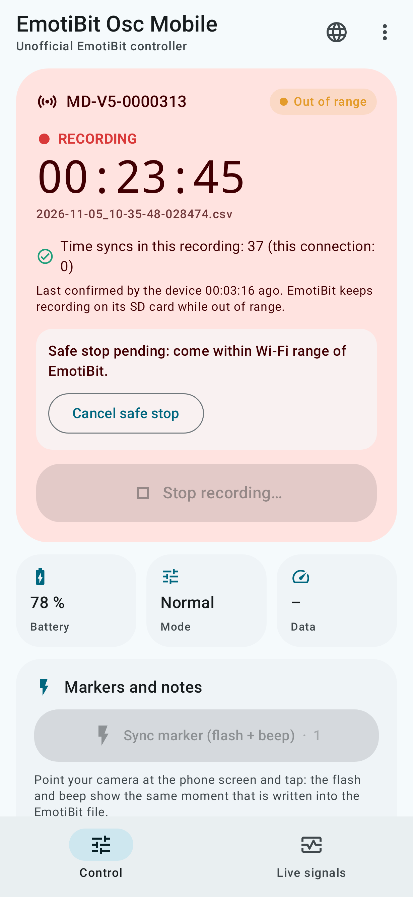
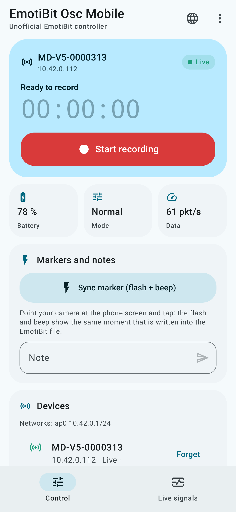
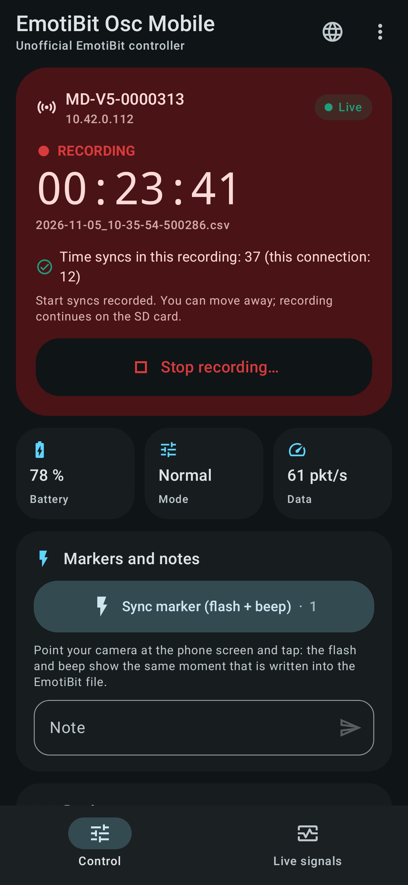
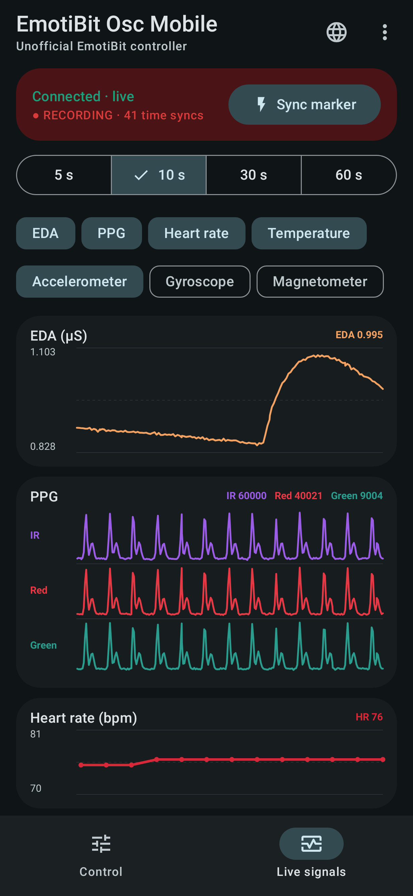
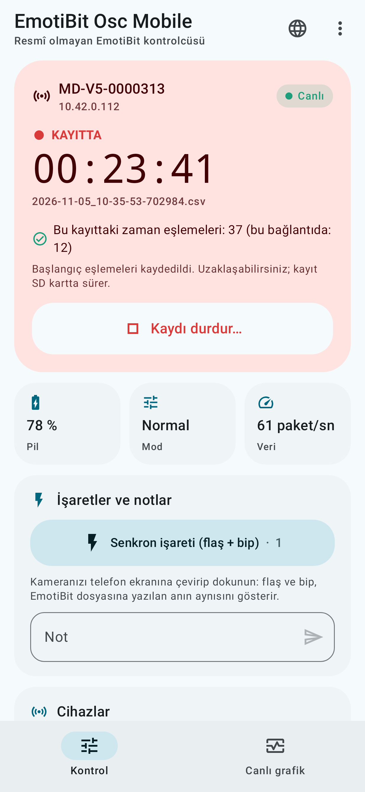

# EmotiBit Osc Mobile

**Start, watch and stop EmotiBit recordings from an Android phone: no laptop in the field.**

[](https://github.com/alparslanguvenc/Emotibit-Osc-Mobile/releases/latest)
[](https://github.com/alparslanguvenc/Emotibit-Osc-Mobile/actions/workflows/ci.yml)
[](LICENSE)


> **Unofficial.** This is an independent community project. It is not made, affiliated with or endorsed by EmotiBit / Connected Future Labs. "EmotiBit" is used only to say which device the app works with.

<p align="center">
  
  
  
</p>

## Why

[EmotiBit](https://www.emotibit.com/) records to its SD card, but a host computer running *EmotiBit Oscilloscope* has to start the recording, answer the device's **time syncs**, and stop the recording. EmotiBit DataParser needs time syncs near the start and the end of a file to convert the device clock to real time and correct clock drift. Outdoors (cycling, walking, field studies) that means carrying a laptop or connecting again at the end.

EmotiBit Osc Mobile does the host's job from your phone, over the phone's own Wi-Fi hotspot.

## Features

- **Discovery and connection** over a phone hotspot or any shared 2.4 GHz Wi-Fi, with broadcast and unicast discovery and a manual IP fallback.
- **Start / stop recording** with a timestamped file name, exactly like the Oscilloscope (`RB` / `RE`).
- **Time syncs answered within EmotiBit's 100 ms window.** The app also checks the echoed `RD → TL → AK` packets with DataParser's own rule, so you can see how many syncs actually went into the file.
- **Made for losing the connection.** EmotiBit keeps recording on its SD card. The app keeps searching in the background, reconnects automatically whenever you come back in range, and collects fresh time syncs each time.
- **Safe stop.** It collects 3 fresh time syncs, then ends the recording, so the end of the file is synced too. You can press it while out of range: it runs as soon as the device is reachable again.
- **Live signals.** Scrolling plots of EDA, PPG (IR/red/green), heart rate, temperature, accelerometer, gyroscope and magnetometer, with a 5/10/30/60 s window.
- **Sync marker.** A white flash and a beep on the phone, written into the EmotiBit file as a note (`SYNC_MARKER_n`) at the same moment. Use it to align video (e.g. a 360° camera) with the biosignals.
- **Notes** written into the recording, **Wi-Fi-off** and **hibernate** commands, and battery, mode and data-rate status.
- **Session log** (JSON Lines) with connections, losses, markers and every sync's round-trip time. You can share it from the app.
- English and Turkish UI, light and dark theme. Runs as a foreground service, so it keeps working with the screen off.

<p align="center">
  
  
  
  
</p>

<sub>Screenshots are rendered from the app's real UI code. The live plots show data streamed through the app's real protocol engine from the bundled EmotiBit simulator, not from a person.</sub>

## Requirements

| | |
|---|---|
| EmotiBit | EmotiBit with Adafruit Feather **ESP32 Huzzah** or **M0 WiFi**, stock firmware 1.x (protocol checked against firmware 1.14 and Oscilloscope 1.16 sources) |
| Phone | Android 10 or newer |
| Network | Phone hotspot (or shared Wi-Fi) on **2.4 GHz**, **WPA2**. EmotiBit does not support 5 GHz. |

## Install

1. Download `emotibit-osc-mobile-<version>.apk` from the [latest release](https://github.com/alparslanguvenc/Emotibit-Osc-Mobile/releases/latest).
2. *(Optional)* Check the file: its SHA-256 is listed in the release notes and in `<apk>.sha256`. The release signing certificate's SHA-256 fingerprint is:
   ```
   7D:D0:78:99:09:BA:47:34:F1:3A:F7:DF:20:A3:1A:87:BF:5B:8D:BF:FB:E2:87:8B:24:F6:98:ED:E0:72:3F:A8
   ```
3. Open the APK on the phone. Android asks you to allow installs from your browser or file manager ("Install unknown apps"). This applies to every app installed outside an app store.
4. Google Play Protect may offer to **scan the app** because it has not seen it before. Choose *Scan app*: the scan checks the app and then lets the install continue.
5. Open the app and allow notifications. On the *Control* screen, use *Open battery settings* and set the app to **Unrestricted**, so Android does not stop it with the screen off.

Updates install over the previous version (same signing key). The app asks for no location, camera, microphone, contacts or storage permissions. See [Privacy](PRIVACY.md).

## Quick start

1. **One-time:** set the phone hotspot to 2.4 GHz / WPA2. Add it to `config.txt` on the EmotiBit SD card. Keep your other networks; EmotiBit tries them in turn.
   ```json
   {"WifiCredentials": [
     {"ssid": "MyPhoneHotspot", "password": "hotspot-password"},
     {"ssid": "HomeWiFi", "password": "home-password"}
   ]}
   ```
2. Turn on the hotspot, then the EmotiBit. The device appears in the app; tap **Connect**. It is remembered.
3. **Start recording** and wait for "Start syncs recorded" (about 10 s).
4. *(Optional)* Point your camera at the phone and tap **Sync marker**.
5. Move away freely. EmotiBit keeps recording, and the app reconnects and syncs whenever you are back in range.
6. At the end, choose **Stop recording → Safe stop**.
7. Copy the files from the SD card and parse them with EmotiBit DataParser as usual.

More detail, including troubleshooting: **[User guide](docs/USER_GUIDE.md)** · [Kullanım kılavuzu (Türkçe)](docs/USER_GUIDE.tr.md)

## Check a recording's time syncs

`tools/emotibit_sim/check_sd_file.py` applies DataParser's time-sync rule to a raw EmotiBit `.csv` from the SD card. It lists the syncs near the start and end, their round-trip times, and the notes and sync markers.

```bash
python3 tools/emotibit_sim/check_sd_file.py 2026-11-05_10-15-30-123456.csv
```

## How it works

The app speaks the EmotiBit Wi-Fi host protocol (CSV-style text packets):

| Step | Channel | Packets |
|---|---|---|
| Discovery | UDP 3131, broadcast + unicast | `HE` → `HH` (with data port and device ID) |
| Connect | UDP 3131, then TCP to the phone | `EC` (control + data port) → EmotiBit opens TCP → `PO` |
| Keep-alive | UDP 3131, every 500 ms | `PN` ↔ `PO` (10 s timeout) |
| Data | UDP data port | sensor packets, `EM` mode/recording status, `B%` battery |
| Time sync | UDP data port, ~every 5 s | `RD` → phone replies `TL` (local time) + `AK` within 100 ms |
| Commands | TCP | `RB` / `RE` record, `UN` note, `MN` / `MO` / `MH` power modes |

Details and design decisions: [docs/PROTOCOL.md](docs/PROTOCOL.md).

## Build from source

```bash
./gradlew :protocol:test        # protocol unit tests + end-to-end runs against the simulator (needs python3)
./gradlew :app:assembleDebug    # debug APK in app/build/outputs/apk/debug/
```

- `protocol/`: pure Kotlin/JVM implementation of the EmotiBit host (no Android dependencies).
- `app/`: Android app (Jetpack Compose, foreground service).
- `tools/emotibit_sim/`: EmotiBit simulator for testing without hardware (Python standard library only). Run it on a laptop joined to the phone's hotspot to try the app without a device:
  ```bash
  python3 tools/emotibit_sim/emotibit_sim.py --verbose
  ```
- Screenshots: `./gradlew :app:testDebugUnitTest --tests '*ScreenshotTest*'` (Robolectric native graphics).

Release APKs are built and signed by GitHub Actions when a `v*` tag is pushed (see `.github/workflows/release.yml`).

## Status and limitations

- **Early release.** Tested with a real EmotiBit V5 (Feather ESP32) for discovery, connection and live signals. Recording and the out-of-range/safe-stop workflow are tested end to end against the bundled simulator, which re-implements the firmware's behaviour. Please try a short pilot recording before an important session and [report issues](https://github.com/alparslanguvenc/Emotibit-Osc-Mobile/issues).
- Live plots show what arrives over Wi-Fi. They are for checking signal quality, not for analysis; analyse the SD-card file.
- File names and `TL` timestamps come from the phone's local clock. Keep automatic date and time enabled.
- No phone GPS logging yet.

## Acknowledgements

Built on the open-source work of the [EmotiBit](https://github.com/EmotiBit) project: firmware (`EmotiBit_FeatherWing`), `ofxEmotiBit` (Oscilloscope, DataParser) and `EmotiBit_XPlat_Utils`, all MIT-licensed. The protocol was implemented from those sources. See [NOTICE](NOTICE).

## License

[MIT](LICENSE)
